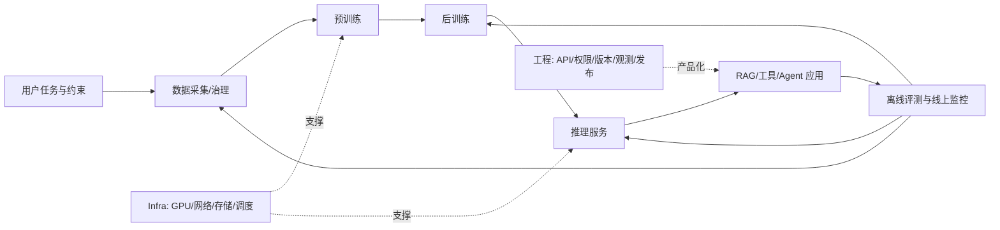

---
aliases:
  - AI 技术全景
  - 大模型五日速查
tags:
  - ai/overview
  - ai/recruiting
  - ai/teaching
  - ai/product
updated: 2026-10-09
audience: shareable
---
# AI 技术五日全景学习笔记

> [!abstract] 这份笔记解决什么问题
> 这份笔记想把一个大问题讲顺：AI 模型是怎么学出来的，怎么接进产品，最后又怎么证明它真有用？你可以把它当成一张路线图，用来做 AI 招聘、聊产品方案、跟技术团队沟通，也可以拿去给别人讲。

> [!tip] 怎么读这份笔记
> 每天先用一个生活比方搭直觉，再看真实技术怎么做、用什么指标验证、比方在哪里会失真。比方是脚手架，关键结论仍以机制和证据为准。

**知识更新时间：2026-10-09。**技术栈名称和趋势按所列来源及观察日期整理；开源权重、许可证、硬件支持和框架版本变化快，落地前应核验官方文档与模型卡。

## 一张系统图



可以先把 AI 系统想成一家“内容工厂”：数据是原料，预训练是打基础，后训练像师傅带徒弟，Infra 是厂房和物流，应用是交付给客户的产品，评测就是质检。这个比方帮我们记住分工；真实项目里，各环节会反复迭代，不是一次走完的流水线。

聊任何 AI 项目，都可以先问四句：**它要解决什么？里面怎么做？凭什么说有效？什么情况下会失灵？**模型有几 B、用了哪个框架、榜单多少分，都只是线索，还得看证据。

## 第 1 天｜模型如何从文字生成回答

> [!tip] 先打个比方
> 大模型有点像一个非常强的“文字接龙”选手：读完前面的内容，猜下一个最合适的文字片段，再接着猜。这个比方能解释“为什么它一段一段生成”，但别误会成它只会机械背句子；模型内部会利用训练中学到的复杂模式。

### 核心链路

```text
文本 → Tokenizer → Token ID → Embedding/位置表示 → Transformer → Logits
→ 解码出一个 Token → 接回上下文 → 重复生成
```

1. **Tokenizer**：先把句子切成模型认识的小片段，再换成编号。它有点像把一段话拆成不同大小的乐高块；但 Token 不一定是一个字或一个词，不同语言拆法也不一样。拆得多，可能更占上下文和费用。
2. **Embedding**：把编号查成向量，可以粗略想成给每块积木放进一个数学坐标系里。这个坐标不是词典释义，而是模型计算用的内部表示。位置通常通过 RoPE 等方法体现。
3. **Transformer block**：可以把它想成一轮“读上下文、重新整理，再继续处理”。常见结构有 Attention、MLP/FFN、残差和归一化。因果遮罩像一块挡板，不让当前位置偷看后面的标准答案。RoPE、RMSNorm、SwiGLU、GQA 是常见设计，不是所有模型的统一配方。
4. **Attention**：有点像开会时，大家根据当前问题翻回前文找相关线索。Q 像“我现在要找什么”，K 像“每段线索的索引”，V 像“线索里实际带着的内容”。技术上，Q 和 K 算匹配权重，再用权重汇总 V。它不是在查“下一个 Token 的 K”；某个头也不一定就专门负责一个人类能命名的概念。
5. 最后输出头给词表里的候选 Token 打分，叫 **Logits**。解码策略像从候选答案里挑一个：贪心通常挑最高分，Temperature、Top-k、Top-p 会影响选择范围和随机性。它们改变这一次怎么选，不会训练模型。

上下文越长，Attention 要比较的东西就越多，朴素算法的主要开销大致会跟序列长度的平方一起长。可以把它想成桌边人数增加后，彼此要互相核对的关系变多。FlashAttention 像是把资料分批搬到手边处理，减少 GPU 和显存之间来回搬运；它优化计算和内存使用，不是换掉 Attention 的目标。GQA/MQA 则像共用一部分“资料索引”，减少 KV Cache 占用，具体要看速度和质量取舍。

### 训练和推理

| 阶段 | 已知什么 | 主要计算 | 参数是否更新 |
|---|---|---|---|
| 训练 | 训练序列和下一个 Token 的真实目标已知 | 前向计算 → 交叉熵 Loss → 反向传播梯度 → 优化器更新参数 | 是 |
| 推理 | 只有当前输入/上下文，下一个 Token 未知 | 前向计算 → 选一个 Token → 接回上下文 → 重复 | 通常否 |

**再用上课打比方：** 训练像做有答案的练习卷，老师能把整页题目批改后一起调整学习方法；推理像考试时一道接一道作答，下一题要等上一题写出来。这个比方说明了为什么训练较容易并行、生成却有串行步骤。Loss 下降只说明练习卷做得更像训练目标，不保证真实工作就做得更好。

## 第 2 天｜数据、算法与预训练

> [!tip] 先打个比方
> 预训练像让学生读一座很大的图书馆；学生会慢慢学到语言和内容里反复出现的模式。书越多不一定学得越好：错书、旧书、重复复印件会带偏；只剩一本“标准答案”又会让学生见识太窄。重点是原料是否适合学习目标，比例和覆盖是否合理。

### 预训练在学什么

主流 Decoder-only 模型常做 **Next Token Prediction**：给定前文，猜后一个 Token；猜得和训练答案不一样，就算出 Loss，再通过梯度和优化器调整参数。说得口语一点，模型是在大量例子里学“什么东西常一起出现、什么表达常接在后面”，不是像老师一样逐条审稿、判断真假。所以数据从哪来、好不好、各种内容各占多少，都会影响模型学到什么。

### 数据治理是训练系统的一部分

```text
来源/许可/时间 → 解析规范化 → 质量筛选 → 隐私/安全检查
→ 精确与近似去重 → 分类/混配 → train/validation/test 隔离
→ 污染检查 → 数据版本/数据卡 → 消融与评测
```

数据质量要看目标：内容对不对、相关不相关、能不能代表真实问题、有没有覆盖长尾、够不够新、格式有没有坏、来源能不能追溯，以及许可/隐私/安全是否合规。杂乱的错信息像教材里夹着互相矛盾的答案，模型会收到打架的信号；同一篇文章复印一百遍，会显得它比别的知识更“重要”；把考试题提前塞进教材，分数就不可信。可也不能为了干净把口语、难例和少见情况全删掉，否则模型像只做过一种题的学生，换个问法就不会了。

**数据量不是唯一旋钮。** 如果只是教一项范围明确的工作，1 万条认真整理的例子可能胜过 100 万条重复或跑题的例子；但别把它夸成通用定律，通用预训练还是需要大规模、多领域和多表达的数据。清洗到底有没有帮助，要拿固定的留出题集对照测试，而不是看完数据“感觉很干净”。

### 参数量、Token 数与 GPU 预算

只知道“有几张卡”，还算不出该做几 B。就像光知道有几辆车，不知道车速、路况和跑多久，也算不出能运多少货。还要问 GPU 型号和显存、卡间互联、训练多久、实际利用率、精度、故障和存储开销。简化地说：

```text
GPU 数 × 单卡有效算力 × 训练时长 × 硬件利用率 → 可用计算预算 C
C 与目标、数据和内存约束共同决定模型参数 N、训练 Token 数 D 和方案
```

对 Dense Transformer，常用 `C ≈ 6ND` 粗估训练计算量：`N` 是参数量，`D` 是训练 Token 数。你可以把它当预算草图，不是精确报价，更不是按公式按出唯一正确的模型大小。真实开销还要看序列长度、架构、硬件和利用率。Chinchilla 论文给出的 Token/参数关系也来自特定条件，不能当成今天所有模型的固定比例。先做小实验，再用目标评测修正预算。

**Dense 与 MoE：** Dense 像每道题都让同一位全能老师处理；MoE 像前台先分流，把不同题目派给少数专业老师。这样总共可以有很多专家，但每道题只用一部分；代价是前台分配、老师忙闲不均和跨校区传资料（跨卡通信）更复杂。所以“总参数很大”不等于“每个 Token 都用这么多计算”，还要分别问总参数、激活参数、训练算力和部署成本。

### 常见训练栈

| 环节 | 常见技术类别与例子 | 讨论时要问什么 |
|---|---|---|
| 语料处理 | Hugging Face Datasets、DataTrove、Data-Juicer、NeMo Curator、Spark/Ray 类数据计算 | 来源、规模、去重/过滤规则、许可与污染如何审计？ |
| 模型与训练 | PyTorch、Transformers、torchtune；Megatron-Core、FSDP、DeepSpeed ZeRO | 精度、全局批次、并行方式、吞吐、MFU 与故障恢复如何？ |
| 实验追踪 | W&B、MLflow 等 | 数据、代码、配置、模型和评测能否按版本复现？ |

**小团队怎么选：** 通常先看有没有合适的现成基座，再比较领域继续预训练、SFT/LoRA/QLoRA、RAG、蒸馏、量化和高效运行时。就像创业团队先租成熟厨房、改菜单和优化出餐，不一定要从炼钢开始造炉子。从零预训练通用模型，需要数据、算力、团队和商业目标都站得住脚。

## 第 3 天｜后训练、RAG 与 Agent

> [!tip] 先打个比方
> 预训练像读教材打基础；SFT 像看老师示范怎么答题；偏好优化像比较两份答案、告诉模型哪份更合适；RAG 像开卷考试，作答时去资料柜找最新文件；Agent 则像给员工配上搜索、计算、订票等工具。每个比方都有边界，下面会把真正的技术机制说清楚。

### 后训练改变回答行为

| 方法 | 训练信号 | 常见用途 | 关键风险 |
|---|---|---|---|
| SFT | 输入与示范答案 | 指令格式、任务流程、领域表达 | 示范偏差、过拟合、能力遗忘 |
| DPO | 同一提示下偏好答案对 | 让偏好回答相对更可能 | 偏好噪声、长度偏差、迎合评审 |
| RLHF/PPO | 奖励模型/奖励信号加策略优化 | 根据偏好奖励进一步优化 | 奖励投机、训练不稳定、成本高 |
| GRPO 等策略优化 | 依具体算法构造的相对奖励/组采样信号 | 推理或可验证任务的强化优化 | 奖励定义偏差、评测范围狭窄 |

简单记：SFT 是“照着好例子学”，DPO 是“在两种答法里学偏好”，PPO/RLHF 是“根据奖励反复调整行为”。RLHF 是大类，Reward Model + PPO 是其中一种做法；DPO 不等于这条流程。老师给的示范和奖励如果有偏差，模型也会学偏；所以不能光听算法名，得看独立测试和它具体在哪些题上失败。

### RAG：把知识接在推理时

```text
文档解析 → 清洗/权限/元数据 → Chunk 切分 → Embedding/索引
→ 查询改写/关键词+向量召回 → 合并候选 → Reranker 重排
→ 上下文拼装 → 模型回答与引用 → 评测/日志
```

RAG 最像“开卷考试”：先根据问题从资料柜找几份相关材料，再让模型拿着材料作答。换资料不用重训模型，但文档变更后还要更新索引，并确认新版本真被检索出来。企业资料要记清来源、版本、发布时间、生效/失效时间、状态和权限。问当前规定，就优先找当前有效版本；问“2024 年当时怎样”，就按那个时间点找旧版。**文档不是参数，更新文档不会自动改模型权重。**

检索和答案最好分开打分，就像先看图书管理员有没有找到对的书，再看答题的人有没有根据书答对：

- `Precision@k = Top-k 中相关结果数 / k`：前 k 条里有多少相关。
- `Recall@k = Top-k 找到的标准相关证据数 / 标准相关证据总数`：标准证据找回多少。
- 排序看 MRR/nDCG；答案看正确性、引用支持度/完整性和无证据时的拒答。
- Precision/Recall 的标准相关集必须按任务、时间和权限定义。Recall 高、Precision 低通常意味着证据找得较全但噪声多；反过来可能意味着结果干净但漏掉关键证据。

常见做法是两段检索：第一段先多找一些候选，别漏掉关键材料；第二段 reranker 再细排，把更相关的材料推到前面。像先把一摞可能有用的文件都抱进会议室，再请专家挑最相关的几份。专家只能挑桌上的文件，第一段完全没找到的资料，它也变不出来；而候选摞得越高，处理时间和成本也越多。

### 工具调用与 Agent

工具调用可以想成模型给同事开一张任务单：先输出结构化动作，服务检查参数和权限，真正的程序去执行，再把结果交还模型继续回答。Agent 则像一个能分步骤安排任务、使用工具、检查结果、必要时重试的办事员。技术上，它是“模型 + 工具 + 状态 + 控制逻辑 + 权限”，不是单独一段神奇 Prompt。

MCP 可以类比成工具和模型之间的一种“标准插头”，让连接方式更统一；但插头统一不表示工具本身安全、好用，也不保证 Agent 一定办成事。生产系统仍要做最小权限、输入校验、超时/重试、审计和人工确认。步骤明确的事交给普通代码做，真的需要判断的地方再让模型参与。

### 多模态

多模态就是让模型除了读文字，还能看图、听声音、处理视频或空间信号。可以把图片想成先切成很多小块、声音切成片段，再翻译成模型能处理的表示。不同模态的实现不完全一样；看图问答、OCR、语音识别、语音生成和视频理解也不是同一项能力，得分别测效果和延迟。

## 第 4 天｜Infra、推理服务与工程

> [!tip] 先打个比方
> Infra 像工厂里的厂房、道路、仓库和排班系统：模型再聪明，机器放不下、路上堵车、原料来得慢，也做不出稳定产量。推理时则像先听完顾客点单（Prefill），再一道一道做菜（Decode）；提前记住已经处理过的内容（KV Cache）能省时间，但也占台面。

### 训练 Infra：把计算放到多卡上

| 并行方式 | 切分什么 | 主要代价/问题 |
|---|---|---|
| 数据并行 DDP | 每卡模型副本，数据批次不同 | 梯度同步通信 |
| FSDP/ZeRO | 参数、梯度、优化器状态中的部分或全部 | 通信与参数重组；省显存不一定提速 |
| 张量并行 TP | 层内矩阵/张量计算 | 层间频繁设备通信 |
| 流水线并行 PP | 模型层切成设备阶段 | 微批调度和流水线气泡 |
| 专家并行 EP | MoE 专家放到不同设备 | Token 路由、All-to-All 通信和负载偏斜 |

大规模训练往往组合策略。性能还会被 GPU 显存、显存带宽、网络、存储、数据加载和 Checkpoint 影响。关键指标包括有效 tokens/s、MFU、GPU 利用率、通信等待、OOM/重启、Checkpoint 时间和恢复成功率；“显存占满”不是目标，稳定的有效吞吐和最终质量才是。

用仓库比喻并行方式：数据并行是每个车间都复制一套机器、各做一批订单；张量并行是几家车间合起来完成同一台机器的一道工序；流水线并行是把生产线分成前后工段；MoE 专家并行是不同专科车间接不同订单。分得越细不一定越快，车间之间传料和同步也要花时间。

### 推理 Infra：Prefill 与 Decode

- **Prefill** 像先把顾客整张点菜单读完，处理输入并建立 Key/Value 状态；输入越长，等首个 Token 往往越久。
- **Decode** 像一道菜一道菜往外上；模型每生成一个 Token，就要继续算下一步，因此受显存带宽、缓存、调度和并发影响。
- **KV Cache** 像把已经看过的菜单内容记在便签上，后面不用从头重读，能省计算；但便签越多越占桌面，也就是显存会随上下文和并发增加。

常用服务指标：TTFT（等第一口菜/首 Token 的时间）、TPOT/ITL（后续每个 Token 的间隔）、端到端延迟、tokens/s、并发、P50/P95/P99 和单次请求成本。像餐厅一小时接待很多桌，不代表每桌都等得短；吞吐高不一定单个用户感觉快。比较时要用相近的输入/输出长度、并发、缓存状态和硬件。

常见优化有动态拼批（Continuous Batching）、分块管理 KV、前缀缓存、权重/KV 量化、草稿模型先猜再由大模型验（Speculative Decoding），以及把 Prefill 和 Decode 分开排队。它们像调整排班、复用备料、改用更轻的设备，各有收益也各有代价；要在目标负载上实测速度、吞吐、显存、成本和质量。

### 服务工程

生产链路还包含 API 与模型版本、鉴权/限流、队列、超时与重试、缓存、日志脱敏、监控告警、灰度发布、回滚、容量规划和故障恢复。RAG/Agent 增加索引更新、权限过滤、工具审计、引用追踪、提示注入防护和人工兜底。

常见运行时按定位选：GPU 托管可评估 vLLM、SGLang、TensorRT-LLM、NVIDIA Dynamo 等；本地/边缘路线可评估 llama.cpp/GGUF、MLX 等。它们对硬件、模型算子、调度和生态支持不同，选型要以真实负载和版本实测为准。

## 第 5 天｜评测、业务证据与招聘

> [!tip] 先打个比方
> 评测像考试，但不能只发一张选择题就说某个学生“能力最好”。题目要贴近将来的工作，评分标准要靠谱，还要看错在什么地方。招聘也一样：候选人说“性能提升 30%”，要追问跟谁比、怎么测、付出了什么代价。

### 评测要构成证据链

1. **先说清考什么：** 谁在用？输入长什么样？什么算答对？答错会造成什么后果？
2. **留好对照题：** 有基线，数据切分固定，测试题别提前泄漏给模型；还要按领域、语言、时间、权限和难度看分项结果。
3. **挑合适的评分尺：** 写代码看代码测试，RAG 看检索与引用，在线服务看延迟和成本。没有一个总分能回答所有问题。
4. **错题要分析：** 是资料本身错、没搜到、搜到了排错、模型没按资料答、工具失败，还是产品流程有问题？
5. **一次改一件事再复测：** 这样才知道是谁带来了变化；上线后继续灰度、监控，发现回退能回滚。

| 层次 | 示例指标 |
|---|---|
| 预训练/模型能力 | 验证 Loss/困惑度、知识/代码/推理任务指标；Loss 不是应用质量的充分条件 |
| 后训练行为 | 指令遵循、偏好胜率、事实性、安全拒答、格式合规；人工抽样校准 LLM judge |
| RAG/Agent 应用 | Precision@k、Recall@k、MRR/nDCG、答案正确率、引用支持；任务成功率、工具正确率、恢复率、拒答/升级率 |
| 在线服务 | TTFT、TPOT、端到端 P95/P99、吞吐、错误率、可用性、单位请求成本 |
| 业务结果 | 任务完成率、用户改写/纠错率、人工升级率、完成时间、单位业务成本 |

公开基准方便大家横向比较，但题目可能被模型提前见过，或者跟真实用户问题不一样。让另一个大模型当裁判（LLM-as-judge）可以快速批很多答案，但裁判也会偏心：可能喜欢长答案、固定位置或自己的风格。所以要用人工样本校准、打乱答案顺序，并报告分母、数据集、模型版本、负载和基线。只有一个“提升了 10%”却没说怎么测，信息还不够。

### 招聘项目的六步深挖

1. **问题：** 原瓶颈是什么，用户/业务损失是什么？
2. **机制：** 修改的模型、数据或系统组件如何工作？
3. **实现：** 数据规模与处理、模型/框架、硬件、架构、运行流程是什么？
4. **指标：** 基线、数据集、负载、指标口径和版本是什么？
5. **取舍：** 质量、延迟、吞吐、成本、可靠性和安全牺牲了什么？哪个方案失败？
6. **贡献：** 候选人本人做了哪些决策、代码、实验、定位与复盘？

面试时可以把自己当成“项目侦探”：候选人讲结果，你就顺着证据往回查。看训练配置和曲线、数据卡、消融表、检索样例、压测条件、Trace、故障恢复记录和能否复现。只报模型名、GPU 数、提升百分比或榜单排名，还看不出他本人懂多深、做了什么。

### 按岗位调整追问

| 岗位方向 | 优先追问 |
|---|---|
| 算法/研究 | 目标函数、架构选择、基线、数据、消融、泛化和失败样本 |
| 预训练/训练系统 | 数据与 Token 配比、预算推导、并行映射、MFU、通信、稳定性和恢复 |
| 后训练/对齐 | 指令/偏好/奖励数据、SFT/DPO/RL 选择、奖励投机、遗忘和独立评测 |
| 推理/Infra | Prefill/Decode 瓶颈、KV Cache、量化、Batching、P95、并发和成本 |
| RAG/Agent 应用 | 解析/切块、召回/重排、引用评估、权限、工具失败、安全和人工兜底 |
| 评测/质量 | 数据隔离、指标有效性、LLM judge 校准、统计波动、错误分类和回归 |

## 学完后能用到哪些地方

- **做招聘：** 用“问题—机制—实现—指标—取舍—本人贡献”来聊项目。不是考候选人背框架，而是请他拿经历和数据来说明。
- **做产品：** 选 API、开放权重、自建服务、小模型+RAG、微调还是人工流程，要把质量、速度、调用量、数据权限、单次成本和后续维护放在一张账上算。
- **做教学：** 先用生活例子搭直觉，再讲技术怎么实现，最后提醒“比方到哪儿就不准了”，然后让听众自己讲一遍。
- **做跨团队沟通：** 别只说“要更快、更准、更省”，继续问快的是 TTFT 还是端到端？准的是答案还是引用？省的是训练还是每次调用？大家把尺子对齐，才不容易各说各话。
- **看行业趋势：** 论文成绩、官方产品能力、开放权重、社区下载和生产采用是不同信号，不能拿其中一个当全部答案。

## 技术栈速查

| 层次 | 常见组件/例子 | 不要误解为 |
|---|---|---|
| 数据 | Datasets、DataTrove、Data-Juicer、NeMo Curator、对象存储/数据湖 | 工具能自动判定真理或替代数据评测 |
| 模型开发 | PyTorch、Transformers、Megatron-Core、FSDP、DeepSpeed、PEFT/TRL | 某个框架名就能说明算法创新 |
| 检索 | BM25、向量索引、Hybrid Search、Embedding、Reranker、向量库 | Embedding 相似就等于事实正确 |
| 推理 | vLLM、SGLang、TensorRT-LLM、llama.cpp、MLX 等 | 任何运行时都能互换、结果都相同 |
| 评测/追踪 | lm-evaluation-harness、OpenCompass、Ragas、W&B/MLflow 等 | 自动分数等于真实用户价值 |

这张表是地图，不是排行榜。哪个工具最好，要看硬件、模型、负载、团队经验和版本；商用前还得看许可证。不要因为某个工具最近常被提起，就认为它对每个项目都最合适。

## 技术趋势观察｜截至 2026-10-09

1. **能下载权重，不等于什么都开放：** 数据、代码、训练配方和商业许可可能各不相同。真要用，先看 Model Card 和 License，别只听“开源”两个字。
2. **模型之外，推理系统也很关键：** KV 管理、动态拼批、缓存、量化、草稿解码和 Prefill/Decode 调度，都会影响速度、成本和质量；实际收益得在自己的负载上测。
3. **Agent 能多做事，也能多出错：** 一旦模型可以调工具、走多步流程，就要管好权限、状态、失败恢复、审计和人工确认。插头接得上，不代表任务就办得好。
4. **大家越来越需要端到端证据：** 不只看榜单，还要看长上下文、事实和安全、RAG 引用、Agent 成功率、尾延迟与线上成本。
5. **数据依然是地基：** 筛选、去重、混配、合成数据、来源追踪和防污染都会影响结果；“清洗得更干净”不保证能力更强。

**范围说明：** Hugging Face 的《State of Open Models: Summer 2026》看的是 Hub 在 2026 年前七个月发生的活动，可以观察开放模型和本地运行时生态，但不能代表私有部署、API 流量或全行业份额。行业变化很快；看到“最新”结论时，记得核对日期和来源。

## 可复用的 90 秒总述

> 大模型先读很多整理过的资料，通过预测下一个 Token 学语言和内容里的模式；再用示范答案、偏好或奖励，把它教得更会按要求回答。上线后，推理系统负责把问题处理好、把答案一个 Token 一个 Token 地生成出来；应用还可以接资料库和工具。最后要用评测确认答案靠不靠谱、引用有没有依据、速度和成本能不能接受。聊一个项目，别只问模型多大、用了什么框架，要继续问：解决什么问题、数据从哪来、内部怎么做、跟什么比、结果怎么算、代价是什么、候选人自己做了什么？

## 继续学习的链接

- 五日课程导航：[[00-五日导航]]
- [[01-大模型工作原理]] · [[02-算法与预训练]] · [[03-后训练与AI应用]] · [[04-Infra推理与工程]] · [[05-评测与招聘实战]]
- 技术栈趋势：[[06-技术栈与近期趋势]]

## 参考资料

### 论文

- Vaswani et al., [Attention Is All You Need](https://arxiv.org/abs/1706.03762), 2017：Transformer 与 Attention。
- Brown et al., [Language Models are Few-Shot Learners](https://arxiv.org/abs/2005.14165), 2020：规模化语言模型与上下文学习。
- Hoffmann et al., [Training Compute-Optimal Large Language Models](https://arxiv.org/abs/2203.15556), 2022：计算预算、模型规模和数据量的权衡。
- Ouyang et al., [Training language models to follow instructions with human feedback](https://arxiv.org/abs/2203.02155), 2022：InstructGPT/RLHF 路线。
- Rafailov et al., [Direct Preference Optimization](https://arxiv.org/abs/2305.18290), 2023：偏好优化。
- Dao et al., [FlashAttention](https://arxiv.org/abs/2205.14135), 2022：Attention 的 IO 与显存效率。
- Kwon et al., [vLLM: PagedAttention](https://arxiv.org/abs/2309.06180), 2023：LLM 服务的 KV Cache 管理。
- Liang et al., [Holistic Evaluation of Language Models (HELM)](https://arxiv.org/abs/2211.09110), 2022：多维评测。
- [DataComp-LM](https://arxiv.org/abs/2406.11794), 2024：训练数据集构建与统一评测。
- [FineWeb](https://arxiv.org/abs/2406.17557), 2024：大规模网页语料整理案例。

### 官方文档与生态观察

- [PyTorch Distributed](https://pytorch.org/docs/stable/distributed.html) · [Transformers](https://huggingface.co/docs/transformers/index) · [Hugging Face Datasets](https://huggingface.co/docs/datasets/en/index)
- [NVIDIA NeMo Curator](https://docs.nvidia.com/nemo/curator/latest/) · [Model Context Protocol](https://modelcontextprotocol.io/)
- Hugging Face, [State of Open Models: Summer 2026](https://huggingface.co/blog/state-of-open-models-summer-2026), 2026-08-14。其指标范围是 Hugging Face Hub 活动。

### Obsidian 章节导航

本页可独立阅读；在课程库中可进入：[[00-五日导航]] · [[01-大模型工作原理]] · [[02-算法与预训练]] · [[03-后训练与AI应用]] · [[04-Infra推理与工程]] · [[05-评测与招聘实战]] · [[06-技术栈与近期趋势]]。
